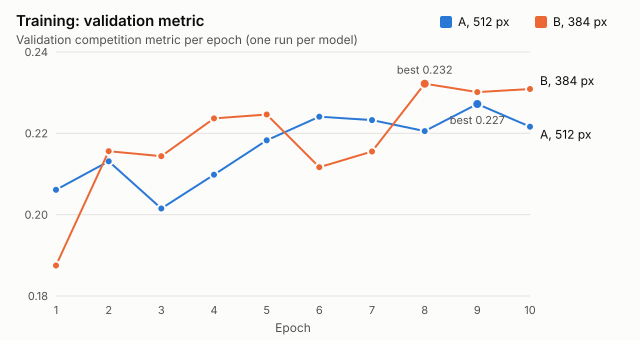
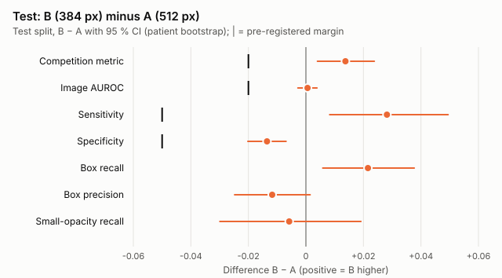
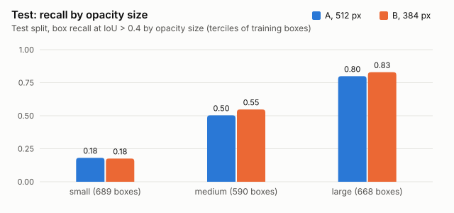

# cxr-pneumonia-detection

[English](README.md)

[RSNA Pneumonia Detection Challenge](https://www.kaggle.com/competitions/rsna-pneumonia-detection-challenge)
の実際の胸部 X 線画像（DICOM）を用いた肺野陰影の**検出**。学習**前**に固定したプロトコル
（[`PROTOCOL.ja.md`](PROTOCOL.ja.md)）に従って 2 つのモデルバージョンを比較し、
[MedVision QA](https://github.com/MousJB/medvision-qa) で検証する。

> **結果（テスト分割、1 回のみ評価）：** 384 px のモデル（B）は、コンペティション指標
> （0.219 対 0.205、Δ = +0.014、95 % CI [+0.004, +0.024]、マージン 0.02）および MedVision QA の
> 3 つの基準のすべてにおいて、512 px のモデル（A）に対して**非劣性**であり、GPU 時間は 1.3 分の 1
> である。各モデル 1 回の学習、GTX 1650 を使用。研究目的のプロジェクトであり、**医療機器ではなく**、
> 臨床的な検証も行っていない。

## 進捗

| ステージ | 状態 |
|---|---|
| 1. 環境構築、ダウンロード、データマニフェスト | 完了 |
| 2. 前処理（DICOM → PNG、患者単位の分割、重複監査、コンペティション指標） | 完了（commit `abfc675`） |
| 3. 計算ベンチマークと事前登録プロトコル（[`PROTOCOL.ja.md`](PROTOCOL.ja.md)、[`config.toml`](config.toml)） | 完了（commit `d4aa648`） |
| 4. A（512 px）と B（384 px）の最終学習、検証セットでの選択 | 完了（commit `afe4b6d`）：B を選択 |
| 5. テスト分割での 1 回限りの評価、MedVision QA、誤り分析 | 完了 |
| 6. 結果、限界、公開 | 結果は以下。MedVision QA デモへの統合は未実施 |

## 結果

すべての数値は `scripts/train.py` と `scripts/evaluate.py` が生成した [`results/`](results/) と
[`reports/`](reports/) に由来する。95 % 信頼区間：患者単位のパーセンタイル・ブートストラップ
（対応のある 2,000 回の再標本化、シード 20261030）。区間は患者の標本抽出のみを反映し、
シードによるばらつき（各モデル 1 回の学習）は含まない。

### 学習と選択（検証分割、2,760 枚、1,145 人）

| 実行 | エポック | 最良エポック | τ | 検証のコンペティション指標 | GPU 時間 | 学習 枚/秒 | 検証 枚/秒 | ピーク GB |
|---|---:|---:|---:|---:|---:|---:|---:|---:|
| A、512 px | 10 | 9 | 0.80 | 0.2272 [0.1976, 0.2561] | 5.76 | 4.82 | 8.01 | 1.63 |
| B、384 px | 10 | 8 | 0.80 | 0.2322 [0.2029, 0.2597] | 4.39 | 6.38 | 10.19 | 1.19 |

両実行とも 10 エポック目より前に最良エポックに達した（`PROTOCOL.ja.md` §6 の定義による
予算内の収束）。非有限の損失なし、スキップされたステップなし。B は §8 の 3 つの選択条件を
満たした（コンペティション指標 Δ の下限 −0.009 > −0.02、感度 Δ の下限 0.000 > −0.05、
小さな陰影の再現率 Δ −0.016 ≥ −0.05）。したがって**テスト分割を読む前に B を選択した**：
[`results/validation_selection.md`](results/validation_selection.md)。学習ログ：
`results/training_log_*.jsonl`。



実行 A はエポック 7 の途中で 1 回中断した：データ読み込みワーカーで Windows のコミット
メモリが不足した（エラー 1455）。`PROTOCOL.ja.md` §6 の規定どおり、エポック 6 の後に保存した
状態から再開し（`--resume`、ログに `resume` イベントとして記録）、エポック 7 を最初からやり直した。
上記の GPU 時間は完了したエポックのみを数えている。

### テスト分割（5,349 枚、2,290 人、1 回のみ評価）

全表：[`results/test/test_results.md`](results/test/test_results.md)。



| 指標 | A、512 px | B、384 px | B − A |
|---|---|---|---|
| コンペティション指標（主要） | 0.2053 [0.1785, 0.2340] | 0.2190 [0.1883, 0.2521] | +0.0137 [+0.0040, +0.0238] |
| 画像単位 AUROC | 0.8883 [0.8749, 0.9028] | 0.8889 [0.8753, 0.9031] | +0.0006 [−0.0028, +0.0038] |
| 感度（画像単位、τ において） | 0.6835 [0.6376, 0.7290] | 0.7117 [0.6654, 0.7533] | +0.0282 [+0.0083, +0.0495] |
| 特異度（画像単位、τ において） | 0.8725 [0.8553, 0.8880] | 0.8590 [0.8407, 0.8758] | −0.0135 [−0.0202, −0.0069] |
| ボックス再現率（IoU > 0.4） | 0.4910 [0.4424, 0.5419] | 0.5126 [0.4619, 0.5626] | +0.0216 [+0.0059, +0.0377] |
| ボックス適合率 | 0.4890 [0.4430, 0.5352] | 0.4773 [0.4311, 0.5259] | −0.0117 [−0.0248, +0.0015] |
| 小さな陰影のボックス再現率 | 0.1814 [0.1476, 0.2149] | 0.1756 [0.1472, 0.2055] | −0.0058 [−0.0299, +0.0191] |

- **主要評価（§9.1）：** B の非劣性、マージン 0.02：**満たされた**（下限 +0.004 > −0.02）。
  検証とテストの結論は一致している。
- **MedVision QA（§9.2）：** C1 AUROC、C2 感度、C3 特異度：3 つとも **SATISFIED**。
  バージョン検証記録：[`reports/vvr_en.html`](reports/vvr_en.html)、
  [`reports/vvr_ja.html`](reports/vvr_ja.html)。入力ファイルは [`medvision/`](medvision/)。
  MedVision QA は独自に患者単位のブートストラップを行う：点推定値は同じで、区間の上下限の差は上表と
  0.004 以内（B − A の差については 0.002 以内）。
- 同じ τ = 0.80 において、B は A より多くの画像を陽性と判定する：感度が高く、特異度が低い
  （−1.4 ポイント、区間はゼロを含まない）。これは動作点の違いであり、検出器として優れている
  わけではない：画像単位の AUROC は同じである。
- 最終実行で測定した A に対する B のコスト：学習スループット 1.32 倍、検証スループット
  1.27 倍、ピーク GPU メモリ 27 % 減、GPU 時間 1.31 分の 1。

### B の誤り分析（テスト、記述的、`PROTOCOL.ja.md` §10）

- **陰影の大きさ：** ボックス再現率は大 0.83、中 0.55、**小 0.18**（学習用ボックスの三分位）。
  小さな陰影は両モデルの主な弱点である（A：0.18）。
- **撮影方向：** AP 画像 0.246（感度 0.79、特異度 0.71）、PA 画像 0.132（感度 0.44、特異度
  0.95）。テスト画像での陰影の頻度は AP（38 %）が PA（9 %）の 4 倍であり、モデルは AP 画像を
  はるかに多く陽性と判定する。
- **偽陽性：** 「No Lung Opacity / Not Normal」とラベル付けされた陰性画像の 23.8 % にボックスが
  予測されたのに対し、「Normal」の画像では 0.6 % であった：偽陽性の 584 枚のうち 574 枚は
  別の異常を示す画像である。
- **年齢：** 0.279（21–40）、0.206（41–60）、0.171（61–80）。80 歳超の群は 40 枚のみ。
  **性別：** 女性 0.226、男性 0.213。
- 陰影のない画像の画像単位コンペティション指標は、ボックスが 1 つでも予測されれば 0、
  されなければその画像は除外される。そのため全表の「0 ボックス」の行は 0.000 となる。
  この群で意味のある指標は特異度である。



図：`scripts/make_figures.py`（コミット済みの結果ファイルから生成。図中の表記は英語）。

### これらの結果の限界

各モデル 1 回の学習（シードによるばらつきは不明）。τ とチェックポイントは検証分割で選択。
分割をまたぐ未確認の近似重複ペアが 887 組。単一読影者によるノイズを含むラベル。検証分割と
テスト分割は Kaggle の学習セットを患者単位で独自に分割したものであり、別の画像を用いた
Kaggle のリーダーボードとは**比較できない**。全項目：`PROTOCOL.ja.md` §14。医療機器ではなく、
臨床性能を主張しない。

## 事前登録された計画（`PROTOCOL.ja.md` の要約）

- **モデル：** torchvision Faster R-CNN ResNet-50 FPN（v1）、COCO 重み、2 クラスヘッド。
  **A** は 512 px（基準）、**B** は 384 px（唯一の変更点）。FPN v2、MobileNetV3、バッチサイズ 8
  はベンチマークで測定したが、学習は行わない（理由は §4.3）。
- **学習：** バランス済みエポック（陽性すべて ＋ 同数の陰性、8,308 枚）、SGD lr 0.005、
  バッチ 4、float32、最大 10 エポック、検証セットのコンペティション指標による早期終了
  （patience 3）、シード 20261030。
- **選択：** 検証セットのみで行う。B が A に対して非劣性（コンペティション指標マージン 0.02、
  感度マージン 0.05、小さな陰影の再現率）であれば B を選ぶ。
- **テスト：** すべての決定を固定した後に 1 回だけ評価する。コンペティション指標（B の非劣性、
  マージン 0.02）と MedVision QA の基準 C1–C3（画像単位の AUROC、感度、特異度）。
- **GPU 予算：** float32 で測定したスループットから、GTX 1650（4 GB）で最大約 12–13 時間。

### 計算ベンチマーク（学習用画像、性能の測定ではない）

float16 混合精度はこの GPU では**動作しない**：ResNet-50 のモデルでは最初のステップから損失が
NaN になり（すべての最適化ステップがスキップされ、ボックスは予測されない）、試したすべての
モデルで float32 より 2.4–2.5 倍遅い。GTX 1650 はテンソルコアを持たない。そのため学習は
float32 で行う。学習していない計算の時間を測った以前の float16 の表は、`PROTOCOL.ja.md`
§5.2 に無効と明記して残している。

| アーキテクチャ | 入力 | バッチ | ピーク GB | 学習 枚/秒（float32） | 実行回数 |
|---|---:|---:|---:|---:|---:|
| R50 FPN v1（実行 A） | 512 | 4 | 1.63 | 4.75 ± 0.19 | 3 |
| R50 FPN v1（実行 B） | 384 | 4 | 1.19 | 6.57 ± 0.04 | 3 |
| R50 FPN v2 | 512 | 4 | 3.54 | 2.75 | 1 |
| MobileNetV3-L FPN | 512 | 4 | 0.75 | 22.40 | 1 |
| R50 FPN v1 | 512 | 8 | 3.43 | 3.64 | 1 |

方法、正しさの確認（有限の損失、パラメータの更新）、cuDNN 自動調整（+6 % でメモリ 2 倍：
オフ）、channels_last、データ読み込み、限界：`PROTOCOL.ja.md` §5。

## データ

コンペティションの規約により画像の再配布は禁止されているため、画像は本リポジトリに
**含まれない**。公開するのはコード、メタデータ、ファイルのハッシュ、予測結果のみである。
再現するには、Kaggle でコンペティションの規約に同意し、API トークン
（`~/.kaggle/kaggle.json`）を作成したうえで、以下を実行する。

```
python -m venv .venv
.venv\Scripts\python -m pip install -r requirements.txt
.venv\Scripts\python scripts/download_rsna.py
.venv\Scripts\python scripts/prepare_rsna.py
```

`scripts/download_rsna.py` はファイル数を確認し、`metadata/raw_manifest.csv`（ダウンロード
した全ファイルのパス、サイズ、SHA-256）と `metadata/raw_summary.json` を出力する。
`scripts/prepare_rsna.py` は 512 px の PNG とボックス・画像の表を `data/`（git の管理対象外）
に、`metadata/split.csv` と `metadata/data_audit.json`（バージョン管理対象）を出力する。

### ステップ 2 の概要（commit `abfc675`）

26,684 枚の DICOM 画像（1024 px、8 ビット）を 2 × 2 の面積平均で 512 px PNG に縮小。
RSNA→NIH 対応表を用いた患者単位の分割（DICOM の `SOPInstanceUID` で画像ごとに確認済み）。
どの患者も複数のセットに属さない。

| セット | 画像数 | 陽性 | 患者数 |
|---|---:|---:|---:|
| train | 18,575 | 4,154 | 8,017 |
| val | 2,760 | 651 | 1,145 |
| test | 5,349 | 1,207 | 2,290 |

**重複監査：** 完全一致（画素の SHA-256）および近似重複（32 px サムネイルの 64 ビット pHash、
ハミング距離 ≤ 4）のペアを `metadata/data_audit.json` に記録。891 組の近似重複ペアが分割
境界をまたぐ。最も近い 4 組を目視で確認し、すべて異なる患者であった。32 px では pHash は
胸部 X 線画像に対して誤った近似重複ペアを生成する。残りの 887 組は確認していない。

## テスト

```
.venv\Scripts\python -m pip install pytest
.venv\Scripts\python -m pytest
```

`tests/test_metric.py`：コンペティション指標。`tests/test_data.py`：すべてのデータ拡張で
ボックスが画像に追従すること（合成矩形）。`tests/test_config.py`：`config.toml` が
MedVision QA の検証を通り、プロトコルと一致すること。
`tests/test_training.py`：バランス済みサンプラー、永続的なデータワーカーへのエポック番号の
伝達、ウォームアップ、早期終了、τ の選択。`tests/test_evaluation.py`：ボックスの対応付け、
画像単位・ボックス単位の指標、AUROC、対応のある患者単位ブートストラップ、選択規則。

## リポジトリ構成

| パス | 内容 |
|---|---|
| `cxr/data.py` | データの読み込み、データ拡張、torchvision データセット |
| `cxr/models.py` | Faster R-CNN の構築（COCO 重み、2 クラスヘッド） |
| `cxr/metric.py` | コンペティション指標 |
| `cxr/training.py`、`cxr/evaluation.py` | サンプラー、早期終了、τ の選択。評価とブートストラップ |
| `scripts/` | ダウンロード、前処理、GPU ベンチマーク（`benchmark.py`、`precision_benchmark.py`）、学習（`train.py`）、評価（`evaluate.py`）、図（`make_figures.py`） |
| `metadata/` | マニフェスト、分割、重複監査（バイト単位で固定、ハッシュ記録済み） |
| `PROTOCOL.md`、`config.toml` | 事前登録プロトコルと MedVision QA の設定 |
| `results/` | ベンチマーク、学習ログ、検証での選択、テスト結果とボックス予測 |
| `medvision/`、`reports/` | MedVision QA の入力ファイル（テスト分割、画像単位）とバージョン検証記録 |

## ライセンス

コード：`LICENSE` を参照。データ：RSNA Pneumonia Detection Challenge のコンペティション規約
（非商用利用に限る、画像の再配布禁止）。
